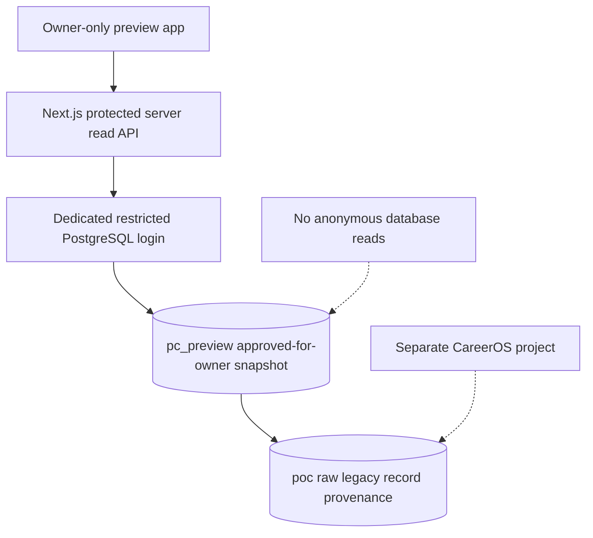

# OPS-002 | Dedicated Supabase Staging: Provisioning and Acceptance Plan

**Prepared:** 2026-11-09 | **Status:** READY FOR OWNER ORGANIZATION/COST DECISION, NOT PROVISIONED
**Related issue:** [OPS-002 #26](https://github.com/amy2213/peptide-clarity/issues/26)
**Scope authority:** PDP-001 v1.0 owner-approved product scope; DEC-005; ARCH-001 G3 design remains provisionally validated and unpassed; GOV-001 change/release gates apply.

## 1. Connected-account inventory and ownership boundary

Live connector inventory checked November 9, 2026:

- **Available Supabase organization:** `Data Weaver 2.0` (org ID `qdkvyusppxsuwkovemhb`).
- **Existing connected project:** `CareerOS`, PostgreSQL 17, `us-east-2` (Ohio). CareerOS is **not** a Peptide Clarity development environment. Do not read, migrate, or alter its data/tables/functions/roles/secrets.
- **Peptide Clarity staging:** No separate project currently exists.
- **Target project name (proposed):** `Peptide Clarity Staging`. **Organization choice and region must be explicitly confirmed by owner; no organization selection inferred just because only one is listed.**

No billing or project provisioning has been performed. Cost must be quoted for the **owner-selected organization** and any nonzero recurring cost accepted before create. A zero-price quote may be created only after the owner confirms the organization and project purpose. Deployment/production publication remains separately gated.

## 2. Staging architecture and minimum viable permissions

**Environment separation:** A new Supabase project with its own Postgres cluster, service keys, database credentials, project URL and resource budget. Never create a Peptide Clarity schema in CareerOS as a shortcut.

**Database exposure design:** Keep `poc`, `pc_preview`, `audit`, and staging-review schemas **outside all exposed Supabase Data API schemas**. Explicitly restrict Postgres schema `USAGE`, SELECT/INSERT/UPDATE/DELETE grants, and test RLS on each source and projection table. RLS alone is not enough when a role has unexpected schema grants, and an unexposed schema is not alone sufficient if a privileged server connection leaks. If Data API remains enabled for `public`, leave it free of project records and verify no anonymous grants or views expose private data.

**Roles:** Raw import is a controlled migration/operator task. Stage API uses a separate read-only login inheriting only `pc_preview_reader` on reviewed owner-test snapshots. No use of Supabase `service_role` in web app, preview builds, or client JavaScript. A new editor identity, ideally with MFA and short sessions, must be designed before any hosted editing dashboard. The current preview-token guard is for internal proof only, **not production user authentication**.

**Hosting:** Do not deploy the Next.js app to a publicly reachable preview merely because the database exists. Use provider access protection plus owner authentication, server-side credential storage, and default noindex (noindex is not a privacy boundary). No direct browser reads to private Supabase schemas.

## 3. Explicit pre-create decision worksheet

| Parameter | Current proposal | Approval needed |
|---|---|---|
| Supabase organization | Data Weaver 2.0 | **OWNER MUST SELECT** |
| Project name | Peptide Clarity Staging | Owner selection |
| Region | U.S. region to be chosen; existing CareerOS is `us-east-2` | Owner acceptance of region/data residency |
| Plan/tier | Lowest viable noncommercial staging resource | Quote actual current organization-specific cost, including billing recurrence |
| Data | Publicly existing 84-entry research fixture, synthetic regulator/pharmacy examples, no health records | No secrets, private correspondence or human-subject medical records |
| Destruction/retention | Disposable staging with controlled evidence fixtures, independent Git and export/backup | Owner acceptance of retention/deletion policy |
| Production/publicity | **NO** | Separate G6/G7 approval required |

**Stop rule:** If an organization is not explicitly chosen, or a nonzero quoted cost is not explicitly approved, **do not create the project**. Avoid incidental project provisioning or cost charges through tools.

## 4. Planned provisioning runbook, not yet executed

1. Confirm organization, project name, U.S. region and actual current cost using provider quote. Record owner decision and billing limits in GitHub OPS-002.
2. Create a **new Supabase project**. Record project ref and region, never credentials, in the private/appropriate deployment configuration. Tag it staging, not production.
3. Run a nonsecret configuration inventory. Confirm Data API exposed schemas, extensions, automatic grants and default public-schema permissions; review security advisories/changelog applicable to Postgres 17.
4. Establish or confirm isolated migration operator context. Apply the reviewed `poc` schema and owner-preview projection migrations from `poc/sql/postgres/001..006` only after Supabase-specific compatibility review. These disposable CI scripts contain demo roles and are **not** to be executed blindly with production admin rights.
5. Load the existing public JSON fixture with recorded SHA-256. Verify 84 catalogue entries, 104 aliases, 41 source records, 37 claims, five company dossiers, 15 lot-association observations with 14 provisional seller/code groups, and five open/partially inspectable evidence issues. Never silently upgrade approvals.
6. Create a restricted staging application identity. Verify direct connection vs pooler behavior and actual PostgREST exposure using **separate anonymous, authenticated and restricted-login requests**. Do not assume a custom `NOLOGIN` role works unchanged through the managed pooler.
7. Run negative role tests, report snapshots, migration reconciliation, emergency deny-switch, live server/API query contract checks, connection timeouts and audit observations.
8. Test backup/restore capabilities and data export appropriate to chosen plan; record RPO/RTO and limitations instead of assuming paid plan features exist on free tier.
9. Only after dedicated review and secure preview hosting approval, connect Next.js internal staging with server-only environment variables. Avoid preview domain that is anonymously viewable.
10. Record exact run IDs, environment ID, diff, security advisories, open deficiencies and owner disposition. **Do not declare G3/G7 passed solely on successful migration.**

## 5. Required acceptance evidence

| Test ID | Test and negative case | Exact expected result |
|---|---|---|
| STG-001 | Verify project ref, org, and database project origin | Peptide Clarity Staging is a distinct Supabase project, CareerOS unchanged |
| STG-002 | Query private source tables anonymously through Supabase Data API | Denied or no exposed route; no raw research rows |
| STG-003 | Query owner-preview schema as anon and basic authenticated user | Denied, no hidden docs, summaries or privileged metadata |
| STG-004 | Query as dedicated restricted server identity | Exactly the owner-preview projection rows visible, read-only |
| STG-005 | Attempt update/publication as restricted server identity | Denied and auditable |
| STG-006 | Disable owner snapshot and query through server | Zero rows; no stale public/CDN cache disclosures |
| STG-007 | Attempt unauthorized source ingestion, database privilege escalation, browser secret exposure | All denied; no service-role keys in bundle/logs |
| STG-008 | Data migration reconciliation | All exact source counts, foreign keys and raw hashes match; no inferred FDA products/lab verifications |
| STG-009 | Verify default public schema and RLS/security advisers | No accidental grants/views/functions exposing private material |
| STG-010 | Restorable export or backup drill | Record tested method, measured restore, retention and plan limitations |
| STG-011 | Five protected Next.js routes against hosted stage | GET-only, auth/error/no-store behavior, and linked claims agree with golden fixture |
| STG-012 | Review cost, quota and billable events | Owner understands actual plan, monitoring/quotas and stop condition |

**Status of STG-001...012:** NOT RUN on hosted Supabase. Existing GitHub Actions tests are **disposable PostgreSQL only**.

## 6. Risks and practical alternatives

- **Cost/limits:** A free project may suspend on inactivity, lack some backup guarantees, or restrict computing; verify plan details before promising an always-available staging site. Charge-bearing project creation is expressly gated.
- **Security:** A public GitHub Pages URL is not a private admin environment; a secret header is not enough for a real public hosted staging tool. Authentication, access protection, rate limiting, cookie/CSRF posture, logs and rotation need review.
- **Data identity:** Existing vendor lot codes and COAs are seller observations; a matching code is not verified physical lot or third-party issuer authentication. Regulatory/category labels in legacy data do not create approved drug records.
- **Alternative:** Continue disposable PostgreSQL and CI while evaluating G2 until hosted costs/organization are approved. This remains technically productive and does not create ongoing bills.

## 7. Decision record status

- Product definition scope: approved (DEC-005).
- Isolated data/API feasibility: demonstrated by PR #25 and its tests.
- **Dedicated Supabase project: NOT CREATED.**
- **Organization selection and cost: NOT APPROVED.**
- G2 evidence validation: OPEN, external interviews deferred under DEC-002.
- G3 full architecture/hosted security gate: OPEN.
- G7 qualified public medical product launch: NOT APPROVED.

The next authorized external action is to **obtain the owner's explicit organization selection** and quote the actual current project cost. No provisioning is allowed merely by the existence of this runbook.
