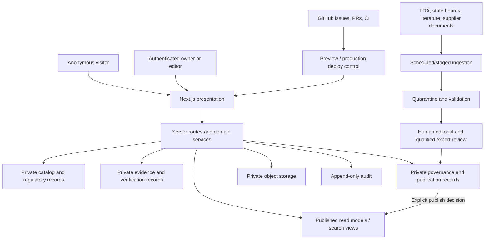

# ARCH-001 | Peptide Clarity G3 Architecture Blueprint
**Version:** 0.1 (2026-11-08)\
**Status:** PROVISIONAL / FOR OWNER REVIEW. G3 **NOT PASSED**. Not an implementation, procurement, hosting, or public-launch authorization.\
**Parent controls:** GOV-001 (approved), PDP-001 v0.2 working + proposed v0.3 scope addendum (not PDP v1.0 approved), DEC-001/002 owner-led exception, DEC-004 bounded owner-testing preview.\
**Change tracking:** [ARCH-001 issue #16](https://github.com/amy2213/peptide-clarity/issues/16), [REQ-010 #7](https://github.com/amy2213/peptide-clarity/issues/7), [REQ-011 #8](https://github.com/amy2213/peptide-clarity/issues/8), [REQ-012 #9](https://github.com/amy2213/peptide-clarity/issues/9), [REQ-013 #10](https://github.com/amy2213/peptide-clarity/issues/10), [REQ-014 #11](https://github.com/amy2213/peptide-clarity/issues/11).

> A G3 candidate can be designed before G2 is passed under bounded owner-led exploration. It cannot be locked, promoted to Ready to Build, or treated as G3-complete while the G2 product scope and required validation are outstanding.

## 1. Executive decision proposal

Build a **modular monolith** with a clear three-layer boundary:
1. **Presentation:** Next.js/React and TypeScript; accessible, mobile-first, black-and-teal 3D presentation as decorative styling only.
2. **Application:** Next.js server-side route handlers/services; domain validation, server-mediated search, evidence views, comparison composition, editorial commands, scheduled ingestion, authorization and publication.
3. **Persistence:** PostgreSQL (candidate: Supabase), object storage for immutable/source documents, migrations, audit records and prepared public read models. GitHub is the software-change source of truth, **not** the business-data store once migrated.

**Hosting candidates:** Vercel for app/preview; Supabase managed PostgreSQL/Auth/Storage. Keep GitHub Pages v0.9.1 intact as rollback/read-only baseline during migration.

**Do not build initially:** microservices; independent search SaaS; public accounts; community scores; automated clinical conclusions; affiliate vendor ranking; private medical uploads; real-time scraper-driven prices; purchase referral to unapproved human-use research compounds.

**Why:** one TypeScript language across front-end/application; relational traceability of substances, products, claims, documents, supplier-lot records; lower operating complexity than microservices; easier release gating. Alternative B: Astro + PostgreSQL if evidence content dominates and interactions prove lightweight. Alternative C: keep static site + versioned JSON for an intermediate no-login preview. Decision remains reversible until tested.

## 2. Verified legacy baseline, source and qualification

Read from the `main/index.html` embedded `<script id="researchData">` record as of 2026-11-08. This is **source data for migration**, not independently reviewed scientific truth.

| Entity | Observed | Qualification |
|---|---:|---|
| Substance/index entries | 84 | 71 not completed research profiles; group includes non-peptides and marketing blends |
| Aliases | 104 | Some aliases are product/brand/marketing terms; classify before using as exact synonym |
| Claim records | 37 | All unique IDs, references to `sources` resolve; scientific review mostly pending |
| Source records | 41 | 30 `SRC-*` and 11 `SUP-*`; dates sometimes human-readable/free-text |
| Company dossiers | 5 | Public desk observations, not legal-entity verification |
| Legacy lot-association rows | 15 | Represent 14 distinct (company, reported lot string) keys, **not 14 independently authenticated physical lots** |
| Unresolved evidence issues | 5 | Preserve as open, not silently corrected |
| Source-linked profile drafts | 13 | Expert-reviewed status not established |
| Dedicated `plainEnglish` objects | 8 | Others require authoring/review; they may still have a summary |

**Critical observed duplicate:** `polaris / POL-GLOW50-2` appears twice with different associated substance IDs (`bpc-157`, `ghk-cu`). Treat as two preserved **source associations** to a *candidate* one-lot key, with identity unverified. Do not create two certified lots or assert blend contents from this normalization alone.

## 3. Scope and three distinct interpretation paths

**Path A: FDA-approved medicines / lawful access.** User searches substance, views **specific FDA-approved finished products and indications** with source-linked authority, and may research legitimate prescription channels and date-checked licensed pharmacy status. No bypass of prescriptions and no approval inferred from a compound slug or NDC alone.

**Path B: Compounded medications.** A separate type with compounding-entity, regulatory framework and jurisdiction-specific disclosures. A compounded preparation is **not an FDA-approved finished product**. Its legal status is contingent and must not be inferred from an active ingredient's approved drug.

**Path C: Non-FDA-approved research companies / documentation.** User investigates company-published listings, lots, COAs, reports, discrepancies, observed prices with date/currency/units, and authentication status. Describes documents, not safe human-use vendors. No user-facing safety certification or unapproved-product personal-use purchasing referral.

**Cross-cutting:** ingredient names are not products; seller listings are not drug approvals; COAs are not clinical evidence; marketing blends are not interchangeable with a single chemical entity; source-linked is not independently verified.

## 4. Context and trust boundaries

There is **no direct visitor write path** to private research, documents, or approval tables. Public responses are explicitly projected, published, and redacted DTOs. The admin commands are server-only and protected by authorization (not merely authentication). Automated ingestion never publishes records.

## 5. Data model, boundaries and authoritative references

See [DATA-006 Logical ERD](DATA-006_LOGICAL_ERD_v0.1.md) for entity relationships, proposed keys, constraints, normal forms and example DDL. See [DATA-007 Migration Crosswalk](DATA-007_LEGACY_MIGRATION_CROSSWALK_v0.1.md) for **field-level** import rules and reconciliation.

**Data domains:**
- Catalog: `substances`, `substance_aliases`, `products`, `product_ingredients`, `product_listings`, `organizations`, `organization_roles`.
- Regulatory/access: `regulatory_product_records`, `approved_indications`, `pharmacy_licenses`, `access_observations`, `price_observations`.
- Evidence: `sources`, `claims`, `claim_sources`, `source_documents`, `reported_lots`, `lot_substance_observations`, `lab_reports`, `lab_measurements`, `verification_events`, `evidence_issues`.
- Publication: `content_revisions`, `review_decisions`, `release_snapshots`, `public_profiles`, `correction_cases`, `audit_events`, `ingestion_runs`, `raw_import_records`.

**Design rules:** global immutable surrogate PKs plus `legacy_id`; source IDs not overloaded as trust grades; explicit NULL/unknown not coerced to false; human-readable regulatory labels remain `legacy_*_raw` until verified; a report may reference an unverified issuer; a product can have multiple ingredient associations; an approval applies to a verified **product** and specific indication/jurisdiction, never its entire ingredient class.

## 6. Application module contract

See [ARCH-002 Application Boundaries](ARCH-002_APPLICATION_BOUNDARIES_v0.1.md) for the proposed repository tree, responsibilities, route contracts, access direction and error types.

**Core modules:** `catalog`, `science`, `regulatory`, `pharmacies`, `research-suppliers`, `evidence`, `comparisons`, `editorial`, `ingestion`, `publication`, `audit`.

**Rule:** Compare module composes facts via domain services, **never** assigns global vendor safety/recommendation scores. Client components render already-authorized display DTOs; secrets, authorization and publishing commands remain server-side.

## 7. Hosting, environments and security

See [SEC-001 Hosting and Threat Model](SEC-001_HOSTING_SECURITY_THREAT_MODEL_v0.1.md).

**Environment boundaries:** Local development, isolated preview/staging with synthetic or redacted data, and production only after applicable G6/G7 decisions. Supabase project separation strongly preferred for staging vs production; secrets scoped to each deployment environment. No preview may silently expose private unreviewed source records.

**Identity:** anonymous visitor reads published material only; owner/editor/reviewer roles have separate permissions, with no unreviewed write from anonymous clients. Do not derive authorization from editable user metadata. No `service_role` or server secrets in browser bundles.

**Database:** private schemas not exposed to PostgREST; least-privilege grants; Row Level Security on all exposed tables, default deny; public published projections are read-only and contain no hidden columns; validate RLS and API grants independently (they are different controls). No implicit view security bypass.

**Security:** restrict uploads to vetted types and sizes; malware scan before use where applicable; server-side URL allowlists/DNS+redirect/SSRF protections for fetch jobs; rate limit sensitive routes; never render unsanitized source text; CSP and protective HTTP headers; backups/restore drills; immutable evidence content hash and audit trails. Actual implementation must confirm hosting support, environment settings and operational costs.

## 8. Versioned, reversible migration

See [DATA-007 Migration Crosswalk](DATA-007_LEGACY_MIGRATION_CROSSWALK_v0.1.md) and [QA-013 Acceptance Matrix](QA-013_ARCHITECTURE_ACCEPTANCE_TESTS_v0.1.md).

1. Freeze v0.9.1 baseline: commit SHA, `index.html` blob SHA, full embedded JSON, SHA-256 checksum, source snapshot and issue ledger.
2. Extract JSON into versioned **source** and typed staging fixtures with exactly preserved strings, nulls, arrays and identifiers. No scientific edits in migration.
3. Design SQL migrations offline; review keys and traceability with one real BPC-157 lot, one GLP-1 prescription product, and one compounded example (synthetic where needed).
4. Dry-run import into isolated Postgres with `raw_import_records`, provenance, canonical entity targets, 15 preserved lot-observation rows and candidate 14 (company, lot-token) groups. Record all unmerged ambiguities.
5. Reconcile counts and source references; compare search/profile/compare outputs against the v0.9.1 fixtures; keep unapproved regulatory data unpublished.
6. Introduce read-only server API, then the new UI behind a preview domain. Maintain v0.9.1 as independent fallback.
7. Enable editorial commands only after RLS/auth/audit tests pass; build staged ingestion, review/approval and correction workflows.
8. Obtain explicit scoped owner preview promotion then G7 final release only after separately documented reviews. Cutover through a reversible alias/routing operation and tested rollback.

**No dual writes during the initial read-only migration.** If later needed, adopt event-based change records and a replay strategy, not an informal sync between HTML and SQL.

## 9. Observability and lifecycle

Every external research observation has `observed_at`, `source_url`, `source_version/hash`, `review_status`, and `ingestion_run_id` when collected automatically. Price observations carry currency, quantity, unit, jurisdiction and source date; never label historical values “current price” without a freshness policy.

Collect bounded operational telemetry (request latency, fetch failures, stale records, provenance exceptions, failed authorization, publication changes), not visitor health histories. Define retention, corrections, redaction and incident response before going public.

## 10. Required G3 test evidence

[QA-013](QA-013_ARCHITECTURE_ACCEPTANCE_TESTS_v0.1.md) contains test IDs, fixtures, steps and exact expected results for imports, approvals, blended lots, duplicates, authorization, disclosure of unknowns, no automatic publication, licensing status, search, accessibility, CI and rollback. **The specification does not mean the tests have been executed.**

## 11. Assumptions, alternatives and locked decisions

| Topic | Working assumption | Confidence/approval |
|---|---|---|
| U.S.-first pharmacy/regulatory scope | Proposed to reduce jurisdiction complexity | Requires PDP scope approval |
| TypeScript + Next.js | Candidate due to interactive comparisons and shared schemas | Needs migration spike and hosting review |
| Supabase Postgres/Auth/Storage | Candidate for relational evidence and owner/editor roles | No project created under ARCH-001 |
| Vercel deploy | Candidate for isolated previews and rollback | No production move under ARCH-001 |
| Public accounts | Out of scope initially | Needs owner signoff in PDP |
| Search | Database full-text + aliases initially; specialty search later | Benchmark against 84 entries and growth scenario |
| Automated source retrieval | Quarantined staged ingestion only | Feasibility, robots/terms and security review pending |
| Company pricing | Dated observational metadata, no live sale claim | Legal/content review required |
| G3 pass | Contingent on owner-approved PDP v1.0, design review and actual G3 acceptance evidence | **NOT PASSED** |
| Public launch | Separate G7, expert/medical/legal/accessibility/security evidence | **NOT AUTHORIZED** |

**Option review:** keep static site if a lighter solution satisfies validated jobs; choose Astro if nearly all visitor tasks are article browsing. Avoid premature GraphQL/microservices, a dedicated vector database, AI-published evidence, unnecessary public accounts or production commerce tooling.

## 12. G3 sign-off criteria (not currently met)

- [ ] PDP v1.0 approved with product scope, jurisdiction, legal/medical boundaries and source governance
- [ ] ERD sample walkthrough demonstrates claim/source/lot/product/indication and report-issuer traceability
- [ ] Every legacy data field has destination or explicit preserved legacy payload; import count/integrity evidence captured
- [ ] Public/private table privileges, roles and threat model reviewed; no implied publish rights
- [ ] Module contracts and stable DTOs validated by representative sample queries
- [ ] Hosting, backups, costs, secret boundaries and rollback tested in isolated environment
- [ ] QA-013 critical negative tests pass with logs/artifacts and owners
- [ ] Owner records explicit G3 decision, limitations, risks and gate dependencies

**Current outcome: Architecture draft prepared for review. No build-ready approval or G3 gate pass.**

## Linked artifacts

- [DATA-006 Logical ERD and data contracts](DATA-006_LOGICAL_ERD_v0.1.md)
- [ARCH-002 Application and repository boundaries](ARCH-002_APPLICATION_BOUNDARIES_v0.1.md)
- [SEC-001 Hosting, access control and threat model](SEC-001_HOSTING_SECURITY_THREAT_MODEL_v0.1.md)
- [DATA-007 Legacy extraction, field mapping and rollback](DATA-007_LEGACY_MIGRATION_CROSSWALK_v0.1.md)
- [QA-013 Architecture acceptance test specifications](QA-013_ARCHITECTURE_ACCEPTANCE_TESTS_v0.1.md)

**Implementation authority:** none granted by this design artifact.
