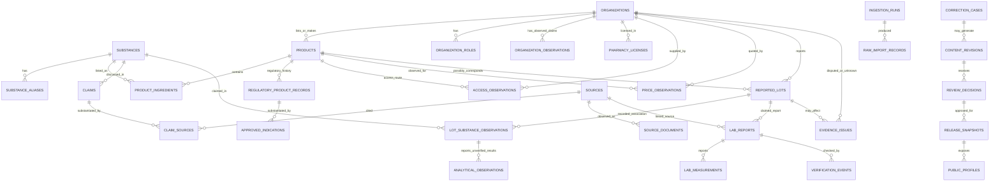

# DATA-006 | Logical Data Model, ERD and Constraints

**Status:** G3 proposed schema, not a live database schema or executed migration.\
**Parent:** [ARCH-001](ARCH-001_G3_BLUEPRINT_v0.1.md). All new entities remain provisional until PDP/G3 approval.

## 1. ERD: research, regulatory, supplier and publication



**Interpretation:** An ERD edge is a permissible relationship, **not proof the relationship is authenticated**. Nullable links and explicit verification states prevent inferring lot/product identity from a retailer's displayed code. `SUBSTANCES` never has a single global FDA approval or vendor-safety boolean.

## 2. Logical entity dictionary and keys

*All tables use immutable UUID surrogate primary keys by default. Legacy identifiers remain unique in their import namespace, not necessarily globally. UTC for technical timestamps. Source publication dates remain separate from observation dates.*

| Schema / table | Key fields / cardinality | Important integrity requirements |
|---|---|---|
| `catalog.substances` | `id`, `legacy_id UNIQUE`,  `name`, `kind`, `legacy_group_raw`, `legacy_category_raw`, `legacy_category_type_raw`, `status` | Kind permits peptide, related non-peptide, protein, blend/marketing term, unknown; no compound-level FDA approval assertion |
| `catalog.substance_aliases` | `id`, `substance_id FK`, `value`, `alias_kind`, `source_id?` | Classify product-brand names, codes and marketing names; preserve raw aliases; no uncontrolled synonym equivalence |
| `catalog.organizations` | `id`, `legacy_id?`, `display_name`, `domain?`, `identity_review_status` | No “licensed” inference from website existence |
| `evidence.organization_observations` | `id`, `organization_id FK`, `legacy_company_id`, `ordinal`, `field_label`, `reported_value_raw`, `note_raw?`, `source_url?` | Preserve the company fields tuple verbatim; company-published value ≠ verified legal, licensing or commerce fact |
| `catalog.organization_roles` | `organization_id FK`, `role`, `jurisdiction?` | Research supplier, approved-drug manufacturer, compounding pharmacy, retail pharmacy, lab, unknown; role claims need source |
| `catalog.products` | `id`, `organization_id?`, `name`, `product_type`, `formulation?`, `status` | Product types segregate FDA-approved finished medicine, compounded, investigational, research listing, blend, unknown; can be draft/undetermined |
| `catalog.product_ingredients` | `id`, `product_id FK`, `substance_id FK`, `reported_amount?`, `unit?` | Many-to-many, provenance and asserted vs verified identity; blend ingredients do not create extra lots |
| `regulatory.regulatory_product_records` | `id`, `product_id FK`, `authority`, `application_number?`, `jurisdiction`, `approval_status`, `source_id`, `verified_at?` | Enforce product scope, authority, source and review date; unverified category does not grant approval |
| `regulatory.approved_indications` | `id`, `regulatory_record_id FK`, `indication`, `population?`, `label_version?`, `source_id` | Only for independently substantiated approved product records, reflect label revision/history |
| `regulatory.pharmacy_licenses` | `id`, `organization_id FK`, `jurisdiction`, `license_id?`, `state`, `verified_at?`, `source_id?` | Status and dates required for 'verified'; expired/unknown not rendered active |
| `regulatory.access_observations` | `id`, `product_id FK`, `organization_id FK`, `jurisdiction`, `rx_required`, `observed_at`, `source_id` | Legal access information, not fulfillment or bypass; eligibility must be reviewed |
| `regulatory.price_observations` | `id`, `product_id FK`, `organization_id FK`, `amount`, `currency`, `quantity`, `unit`, `observed_at`, `source_id` | Nonnegative amount, explicit units/currency/date; optional insurance/coupon qualifiers |
| `evidence.sources` | `id`, `legacy_id UNIQUE`, `title`, `publisher_raw`, `kind_raw`, `url`, `published_raw`, `published_at?`, `observed_at?`, `summary_draft?`, `assessment_draft?`, `trust_type`, `review_status` | 41 legacy records preserved verbatim and classified, publisher name is not proof of issuer authenticity |
| `evidence.claims` | `id`, `legacy_id UNIQUE`, `substance_id FK`, `claim_type`, `title`, `text`, `meaning_raw?`, `evidence_kind?`, `review_raw`, `review_status` | No automatic promotion of desk review to expert approval; revisions tracked |
| `evidence.claim_sources` | `claim_id FK`, `source_id FK`, `citation_context?` | Both FK targets exist; many-to-many, claim-to-document provenance |
| `evidence.source_documents` | `id`, `source_id FK`, `object_key?`, `source_url`, `sha256?`, `observed_at`, `access_scope` | Object storage key is private for restricted artifacts; source may be URL-only |
| `evidence.reported_lots` | `id`, `organization_id FK`, `product_id?`, `reported_lot_code`, `identity_status` | A normalized grouping is **not** verified physical lot identity; potential duplicate held for review |
| `evidence.lot_substance_observations` | `id`, `reported_lot_id FK`, `substance_id FK`, `legacy_row_id UNIQUE`, `observed_at?`, `source_id`, `issuer_authenticated_raw`, `custody_verified_raw` | Preserve **all 15** legacy associations, including two pointing to Polaris GLOW code |
| `evidence.lab_reports` | `id`, `reported_lot_id FK`, `issuer_organization_id?`, `source_id?`, `document_id?`, `issuer_authenticated`, `custody_verified`, `method_review` | Distinct false vs not checked; no report means no invented report row; issuer named ≠ authenticated |
| `evidence.analytical_observations` | `id`, `lot_association_id FK`, `reported_metric`, `result_num?`, `result_text_raw?`, `unit?`, `source_id?`, `evidence_level_raw?`, `report_id?` | Seller-reported purity/assay/testing fields are not lab authentication; valid even with **no** inspected PDF/report |
| `evidence.lab_measurements` | `id`, `lab_report_id FK`, `analyte`, `result_num?`, `result_text?`, `unit?`, `method?`, `interpretation_status` | Numerical value only if represented as reported, with units and method; do not convert/mislabel reported purity as safety |
| `evidence.verification_events` | `id`, `subject_type`, `subject_id`, `verification_type`, `outcome`, `reviewer_id?`, `event_at`, `evidence_source_id?` | Distinguish **not attempted**, attempted/unresolved, verified, disputed, superseded; immutable history |
| `evidence.evidence_issues` | `id`, `legacy_id UNIQUE`, `organization_id?`, `reported_lot_id?`, `source_id?`, `status`, `summary` | Open issues stay open until documented reconciliation |
| `governance.ingestion_runs` | `id`, `source_kind`, `started_at`, `ended_at?`, `status`, `hash?` | Runs are idempotent; failed sources do not publish |
| `governance.raw_import_records` | `id`, `ingestion_run_id FK`, `legacy_collection`, `legacy_id`, `raw_json`, `sha256` | Full lossless preservation, duplicate imports detected |
| `governance.content_revisions` | `id`, `subject_type`, `subject_id`, `version`, `draft_payload`, `author_id`, `created_at` | Private drafts, no hard deletion of published history |
| `governance.review_decisions` | `id`, `revision_id FK`, `review_type`, `decision`, `reviewer_id`, `decided_at` | Explicit approval with scope, required qualified reviewers per risk |
| `governance.release_snapshots` | `id`, `version`, `created_at`, `owner_decision`, `gate_status`, `artifact_hash` | Immutable snapshot; release is not G7 without separate authorization |
| `publication.public_profiles` | `id`, `snapshot_id FK`, `subject_type`, `subject_id`, `public_payload` | Only approved public DTO fields; release scope controls access |
| `governance.correction_cases` | `id`, `subject_id/type`, `submitted_at`, `status`, `resolution_reason` | Fair correction/response channel, redact private correspondence |
| `audit.audit_events` | `id`, `actor_id?`, `action`, `entity_ref`, `created_at`, `before_hash?`, `after_hash?` | Append-only for app roles, critical edits auditable; protect sensitive logs |

`organization_roles`, product and regulatory records beyond legacy supplier dossiers require **new verified data collection**, not fabricated backfill. If a relationship is unsupported, FK remains NULL or an evidence issue remains open.

## 3. Type and state contract

- `regulatory_product_records.approval_status`: `approved | not_approved | withdrawn | pending | unknown` *only within verified product/jurisdiction scope*; no global substance flag.
- `products.product_type`: `fda_approved_medicine | compounded_preparation | research_listing | investigational | marketing_blend | other | unknown`. An `fda_approved_medicine` classification is contingent on corresponding verified product-specific record.
- `issuer_authenticated`, `custody_verified`: nullable booleans with separate evidence events. Legacy `false` stays **false** as an observed field but no automatic inference that verification was attempted; `verification_events` are independent.
- `review_status`: `draft | owner_desk_review | expert_review_pending | reviewed | disputed | rejected | superseded`, always scoped to specific claim/report/entity.
- `published_at`: real timestamp/date only when parseable and source verified; legacy free text remains in `published_raw`.
- Dates are ISO 8601 in storage; original observation date text preserved, with uncertain timezone explicitly documented.
- Money uses `numeric(14,4)` + ISO currency + quantity and unit; no cross-product price ranking unless units/forms/conditions are comparable.

## 4. Constraints and join rules (illustrative SQL, **NOT EXECUTED**)

```sql
-- Schema sketch only. Migrations require owner G2/G3 approvals, review and tests.
create schema if not exists catalog;
create schema if not exists evidence;
create schema if not exists regulatory;
create schema if not exists governance;
create schema if not exists publication;
create schema if not exists audit;

create table catalog.substances (
  id uuid primary key default gen_random_uuid(),
  legacy_id text unique,
  name text not null,
  kind text not null default 'unknown',
  legacy_group_raw text,
  status text not null default 'draft'
);

create table evidence.sources (
  id uuid primary key default gen_random_uuid(),
  legacy_id text not null unique,
  title text not null,
  url text,
  published_raw text,
  published_at date,
  review_status text not null default 'draft'
);

create table evidence.claims (
  id uuid primary key default gen_random_uuid(),
  legacy_id text not null unique,
  substance_id uuid not null references catalog.substances(id),
  claim_type text,
  claim_text text not null,
  review_status text not null default 'draft'
);

create table evidence.claim_sources (
  claim_id uuid not null references evidence.claims(id),
  source_id uuid not null references evidence.sources(id),
  primary key (claim_id, source_id)
);

create table evidence.reported_lots (
  id uuid primary key default gen_random_uuid(),
  organization_id uuid not null,
  product_id uuid,
  reported_lot_code text not null,
  identity_status text not null default 'unverified'
  -- Candidate grouping keys are validated by importer, not assumed globally unique.
);

create table evidence.lot_substance_observations (
  id uuid primary key default gen_random_uuid(),
  reported_lot_id uuid not null references evidence.reported_lots(id),
  substance_id uuid not null references catalog.substances(id),
  legacy_row_id text not null unique,
  source_id uuid references evidence.sources(id)
);
```

**DDL limitations:** This sketch intentionally omits domain-specific tables, RLS policies, triggers, enum/check definitions, indexing, `organization_id` FK until its table exists, and schema grants. It is **not** deployable as a complete migration and should never be mistaken for one.

## 5. Index and query patterns

- `substances(normalized_name)`, `substance_aliases(normalized_alias, substance_id)`; restrict alias expansion for marketed brand/trade terms.
- Full-text index for **approved** public plain-English profiles; status/source visibility in results.
- `claim_sources(source_id, claim_id)` to trace which statements would be affected by revised sources.
- `regulatory_product_records(product_id, jurisdiction, verified_at)` for date-specific approvals; avoid `latest` if not checked.
- `pharmacy_licenses(organization_id, jurisdiction, verified_at)` for license freshness.
- `reported_lots(organization_id, reported_lot_code)` as lookup index but potential duplicates require cautious grouping, not blind unique constraint until normalized and reconciled.
- `analytical_observations(lot_association_id, reported_metric)` for vendor-claimed measurements even without an authenticated laboratory report.
- `price_observations(product_id, organization_id, observed_at DESC)`; do not compare incomparable units.
- `public_profiles(snapshot_id, subject_type, subject_id)` for fast read-only published rendering.

All public queries must be scoped by a **published snapshot** and sanitized DTO. None joins to private notes by default.

## 6. One worked example: source, claim, lot, report

- `substances.legacy_id = bpc-157` (draft substance record).
- `claims.legacy_id = CL-...` with `claim_sources` to one or more `SRC-...` records (science evidence only; reviewer pending).
- `organizations.legacy_id = particle` (company-published identity; legal verification pending).
- `reported_lots.reported_lot_code = PO-2026346` (reported key, not authenticated lot).
- `lot_substance_observations.legacy_row_id = LOT-PAR-BPC-2026346`.
- `sources.legacy_id = SUP-101` vendor index and `SUP-102` inspected seller-hosted PDF, where available.
- `analytical_observations` stores raw seller-reported purity, quantity and microbiology values as applicable, regardless of whether a report is inspected.
- Optional `lab_reports` record if actual report inspected; issuer-named text and verification state separate.
- The resulting public evidence statement, **if reviewed and authorized**: seller-hosted document reports analytical observations for a claimed lot; issuer authentication and custody remain unverified. No medical-use safety inference.

## 7. Architecture review questions

1. Confirm whether a reported physical lot can span formulations or should be partitioned by reported product + seller + lot code.
2. Define exactly what counts as an authenticated COA issuer (response from issuer domain, signed record, etc.).
3. Resolve status terminology and qualified reviewer requirements for specific claim classes.
4. Determine source-document retention and licensing, including PDF redistribution permission.
5. Confirm how much price and pharmacy data can be collected lawfully and kept fresh.
6. Approve public snapshot data contract and private schema boundaries before building API.
