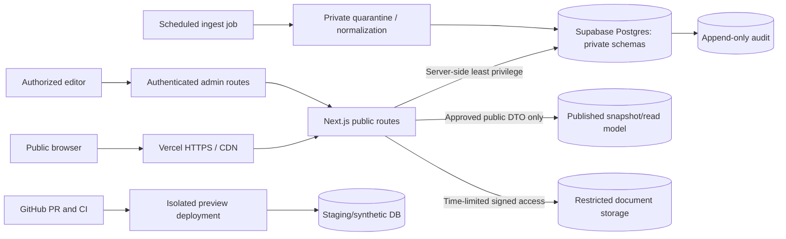

# SEC-001 | Hosting, Authorization, Data Protection and Threat Model

**Status:** G3 PROPOSED, not implemented, pen-tested or approved.\
**Parent:** [ARCH-001](ARCH-001_G3_BLUEPRINT_v0.1.md); [QA-013 tests](QA-013_ARCHITECTURE_ACCEPTANCE_TESTS_v0.1.md). Security is a G6/G7 condition, not a document checkbox.

## 1. Candidate deployment topology



**Public visitor cannot access unreviewed entities through a direct table API.** Server emits approved projections from a specific immutable release snapshot. Admin authorization is independent of public read privileges.

**Hosting tradeoff:** Vercel + Supabase reduce infrastructure maintenance, but add provider spend, region/data-residency choices, network/secrets dependencies and vendor lock-in. Alternatives: static pre-rendered front-end with private batch content export; single managed container + Postgres when server requirements or fees justify it. Evaluate real free/paid allowances and ToS before choosing; this draft does not authorize account creation or billing.

## 2. Environments and Git lifecycle

| Environment | Data | Access | Deployment and decisions |
|---|---|---|---|
| Local | Synthetic + a governed *public-only* legacy snapshot; redacted test files | Developer tools | No production credentials; local CLI/emulators |
| Preview PR | Synthetic/test data, isolated staging resources; no real editor secrets by default | Protected preview URL or access-controlled team | Automatic per-PR build, contract/security checks; no prod writes |
| Staging | Seeded fixtures + separately approved public research snapshots | Owner/editor/reviewer test accounts | Exercises migrations, RLS, recovery and publication workflow |
| Production candidate | Specifically approved/public records + private editorial sources | Anonymous read; authenticated least-privilege edit | Deploy only after review and separate owner authorization |
| Existing GitHub Pages | v0.9.1 prototype unchanged | Public worldwide | Immutable baseline and fallback during transition |

Protect `main` with review+required CI where possible; do not assume settings are enforced until verified. Published content promotion is a **separate approval** from source-code merge. Reusable build artifact hashes and PR SHA are retained.

## 3. Roles, grant boundaries and data paths

| Actor | Anonymous public snapshot | Private unreviewed evidence | Create/edit drafts | Expert approvals | Publish snapshot | System credentials |
|---|---|---|---|---|---|---|
| Anonymous visitor | Read | Deny | Deny | Deny | Deny | Deny |
| Signed-in owner/editor | Read | Restricted to assigned work | Scoped | Only if specifically qualified/authorized | Owner only after gates | Deny |
| Scientific/analytical reviewer | Read | Scope limited by assignment | Annotations only | Reviewer category and exact subject scope | Deny | Deny |
| Source ingestion worker | Deny directly | Write into quarantine/staging only | No public content edits | Deny | Deny | Server-scoped token, not browser |
| Deployment service | Read to verify preview | No blanket production DB write | Deny | Deny | Requires separate release step | Deployment-scoped secrets |

**Supabase/Postgres implementation approach:** private schemas (`catalog`, `evidence`, `regulatory`, `governance`, `audit`) not exposed to the Data API; `publication` read model with explicit grants and Row Level Security if exposed. Defense in depth: enable RLS on every exposed table, and explicit `GRANT` statements, because SQL privileges and RLS are separate. Use owner-defined app roles stored server-side/secured metadata; **not user-editable `user_metadata`**. Protect views with invoker rights or no anonymous access if view/RLS behavior is uncertain. Anonymous clients may receive only server-rendered published DTOs.

**Credentials:** Supabase server secret or service-role capability never embedded in `NEXT_PUBLIC_*`, HTML, Git, browser bundles, logs, or preview deployment variables. Admin SQL/migrations run only from protected CI or approved operator account. Rotate after incident. No browsing account needs admin credentials to read public pages.

## 4. Publication firewall

```text
External content -> quarantined fetch -> normalized observation
  -> claim/source/lot identity validation -> reviewer decisions
  -> explicit OWNER publication transaction
  -> immutable published snapshot -> publicly served DTO
```

- The source ingest job is **read-only to published views** and may not call a publish function.
- Default `published = false` for newly imported evidence. New/changed regulatory statuses and high-risk health claims require provenance, reviewer authorization and a matching approved snapshot revision.
- Release snapshot records include all payload hashes and reviewer/owner decision identifiers. The public site can present older but verified content with explicit `asOf` rather than silently refreshing to unchecked data.
- Corrections supersede past snapshots with a visible correction reference; prior records remain in controlled history.
- Supplier-provided COA is always tagged `vendor_published` until independent document issuer and sample custody steps are separately recorded.

## 5. Threat model

| ID | Threat / misuse | Data or user impact | Mandatory control | Acceptance test |
|---|---|---|---|---|
| SEC-T01 | Anonymous query of draft medical/supplier records via Data API, SSR response or cache | Misleading unreviewed content/private docs leak | Private schema, explicit grants, RLS, public snapshot DTO allowlist | QA-013 S01/S02 |
| SEC-T02 | Account authenticated but unauthorized editor/reviewer changes approval | Forged verification/release | Role+resource authorization, two-person review for elevated topics when adopted, audit, no user_metadata-based policy | S03/S04 |
| SEC-T03 | Leaked service key in Next.js build/preview/runtime logs | Database compromise | Secret isolation, code/deployment scans, rotated scoped tokens, deny public env names | S05 |
| SEC-T04 | Source webpage/document injects script or malicious link | XSS / credential theft | Escape all rich text, sanitize source markdown, allowlist `https:` links and CSP | S06 |
| SEC-T05 | Server fetcher receives redirect to cloud metadata/internal IP | SSRF, secret exfiltration | URL allowlist, DNS/IP and redirect revalidation, egress policy, fetch timeouts | S07 |
| SEC-T06 | Malicious PDF or oversized upload | Malware, storage abuse, DoS | Private bucket, MIME/magic-byte check, file size, virus scan/quarantine, no inline serving of raw risky files | S08 |
| SEC-T07 | Company marketing content incorrectly treated as authenticated COA | Unsafe purchase inference / reputation damage | Independent issuer/custody states, source origin and review record, never safety scoring | D13/D14 |
| SEC-T08 | Stale FDA label/pharmacy license/price treated as current | Misleading medical purchase/access decisions | Source date, `verified_at`, explicit stale/unknown state, refresh SLA and uncertainty | D15/D16 |
| SEC-T09 | Import silently merges two reported lots/blend ingredients | Incorrect chain of custody / lab claims | Candidate group, raw rows, dual association preservation, conflict queue | M05/M06 |
| SEC-T10 | Deploy/CI promotes draft science automatically | Unreviewed medical statements public | Separate signed owner publish decision, isolated deployments and regression gate | P01/P02 |
| SEC-T11 | Evidence edited without immutable history | False auditability and unsupported correction | Append-only audit, versioned source hashes, restricted delete, transaction logs | A01/A02 |
| SEC-T12 | Preview deploy accesses production admin data or accidentally publicly indexed | Personal/supplier source exposure | Staging project and fake data, preview auth, no public credentials, bot rules not privacy | S09 |
| SEC-T13 | Restore fails, provider outage, bad deploy | Extended downtime/data corruption | Documented RPO/RTO, backups, quarterly test restores, immutable release and rollback plan | R01/R02 |
| SEC-T14 | Sensitive personal health data or unredacted supplier correspondence collected | Privacy and legal harm | No public accounts/uploads at MVP, data minimization, separate protected intake later | S10 |

## 6. Regulatory content controls

- **FDA:** Ground statements in a verified product/application/indication record with source and review date. Ingredient name, an NDC or a retailer's assertion is never sufficient to mark a product FDA approved.
- **Compounding:** Different category; no claim FDA-approved for compounded finished drug; pharmacy and legal status require verification of applicable location/time/regulatory framework.
- **Research only:** Supplier dossier comparisons are informational and never certify safe human use. No unapproved-substance dosing, clinical endorsement or buying referral for personal use.
- **Lab:** HPLC purity does not establish sterility, authenticity, identity, potency, endotoxin absence or medical suitability. Each assay documented separately and ambiguities visible.
- **Corrections:** Company disputes/updates cannot silently replace recorded evidence; keep original snapshot and dated resolution.

## 7. Operations, retention and availability

- Configure TLS, HSTS when appropriate, CSP, referrer, content-type and permissions headers; verify in actual deploy rather than assuming defaults. Avoid wildcard CORS on admin routes.
- Logs: request IDs, authorization failures, source retrieval status, publication transitions, migration validation, hash errors. No medication histories, full uploaded COAs, passwords, tokens or raw PII in logs.
- Data retention: retain published evidence and decisions as needed for explainability, define document licensing/retention and correction windows with legal review. Public analytics anonymous/aggregated by default.
- Jobs use backoff, idempotency, timeouts, retries with capped queue depth, failed fetch alerts; on failure keep prior approved snapshot.
- Database backups must include private evidence and metadata; object storage separately protected and restorable, with tested RPO/RTO. Git history alone is not a database backup.
- Publish rate limits and abuse controls, especially query/compare and login routes.
- Monitor unusual role escalations, revisions without approvals, stale licenses/regulatory records, broken source URLs, database latency, and failed data import reconciliation.

## 8. Pre-deployment checklist / open decisions

- [ ] Hosting budget and billing caps reviewed; staging and production resources isolated
- [ ] Data jurisdiction and document redistribution/license policy reviewed
- [ ] Table-level grants, schema exposure and RLS policies explicitly tested with anon/editor/reviewer/service principals
- [ ] Secrets scanned in source, GitHub Actions variables and preview/browser bundles
- [ ] Automatic publish technically impossible from ingestion identity
- [ ] Preview protection and synthetic-only data verified
- [ ] Server APIs rate-limited, input validated and free from raw internal object/stack leakage
- [ ] SSRF and XSS hostile document fixtures rejected
- [ ] Incident runbook, alert owner, restore and rollback drill completed
- [ ] Pharmacy and scientific/regulatory claims reviewed by appropriate qualified people
- [ ] Release authorization documented in GOV-001-compliant record; G7 separately approved when applicable

Relevant official implementation references to recheck during build: [Supabase securing API](https://supabase.com/docs/guides/api/securing-your-api), [Supabase RLS](https://supabase.com/docs/guides/database/postgres/row-level-security), [Supabase security docs](https://supabase.com/docs/guides/security), [Vercel environments](https://vercel.com/docs/deployments/environments), [Vercel environment variables](https://vercel.com/docs/environment-variables). Product-specific behavior, prices and features are not assumed to remain unchanged.

**Outcome:** Security design proposed; no actual controls or tests are claimed implemented.
